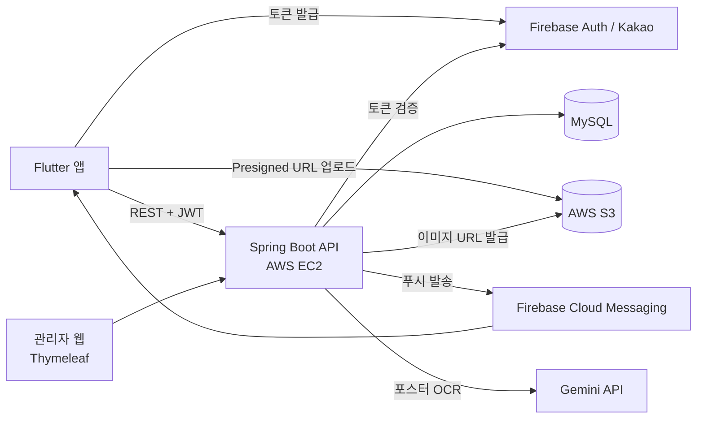

# FEPLE Backend

페스티벌 정보와 라인업을 보고 팬끼리 소통하는 커뮤니티 앱 **FEPLE**의 Spring Boot 백엔드입니다.

**다운로드** [App Store](https://apps.apple.com/kr/app/feple/id6804336803) · [Google Play](https://play.google.com/store/apps/details?id=com.dobino.feple)

**앱 코드** [feple-frontend](https://github.com/yangjaehoon/feple-frontend)

<!-- 스크린샷: 관리자 페이지 이미지를 docs/screenshots/에 넣고 여기에 추가 -->

## 핵심 문제 해결

| 문제 | 원인과 해결 | 근거 |
|------|------|------|
| 온보딩에서 페스티벌을 여러 개 고르면 등록이 간헐적으로 실패 | 매칭 없는 선행 DELETE의 InnoDB 갭 락과 INSERT의 순환 대기가 원인. 존재 조회로 분기해 추가 경로를 순수 INSERT로 변경 | [수정 커밋](https://github.com/yangjaehoon/feple-backend/commit/a6de7d1c) |
| 회원탈퇴가 성공 응답을 주고도 DB에 반영되지 않음 | `clearAutomatically`가 영속성 컨텍스트를 비워 엔티티가 detached 상태가 됨. 명시적 `save()`로 병합하고, 같은 원인의 인증샷 승인 버그는 `flushAutomatically`로 수정 | [회원탈퇴](https://github.com/yangjaehoon/feple-backend/commit/ecc9ead0), [인증샷 승인](https://github.com/yangjaehoon/feple-backend/commit/e0d96581) |
| 관리자 포스터 OCR이 원인 구분 없이 500으로 실패 | 오류 로깅으로 503과 시간 초과를 확인. 실패 유형별로 재시도, 경량 모델 전환, 즉시 실패를 나눔 | [PR #111](https://github.com/yangjaehoon/feple-backend/pull/111), [PR #112](https://github.com/yangjaehoon/feple-backend/pull/112) |

## 아키텍처



## 기술 스택

| 분류 | 기술 |
|------|------|
| 언어 / 프레임워크 | Java 17, Spring Boot 3.5, Spring Security |
| 데이터 | MySQL, Spring Data JPA, Flyway |
| 인증 | Firebase Auth, Kakao OAuth, JWT |
| 인프라 | AWS EC2, S3, GitHub Actions |
| 안정성 | Bucket4j Rate Limiting, ShedLock, Micrometer + Prometheus |
| 외부 연동 | FCM, Gemini API |
| 테스트 | JUnit5, Testcontainers, JaCoCo |

## CI/CD

- **PR 게이트**: Spotless, 컴파일, 테스트, SpotBugs, JaCoCo 커버리지를 통과해야 `main`에 병합됩니다.
- **자동 배포**: `main`에 병합되면 GitHub Actions가 JAR를 빌드해 EC2에 배포합니다.
- **시크릿 관리**: 민감 정보는 저장소에 두지 않고 GitHub Secrets로 주입합니다.

<details>
<summary><strong>주요 기능 전체 보기</strong></summary>

- **인증** — Firebase Auth(이메일/소셜), 카카오 로그인, JWT 액세스/리프레시 토큰
- **페스티벌** — CRUD, 장르·지역 필터링, 좋아요, 타임테이블, 부스 맵, 공기질(AQI) 정보, 셋리스트 변경 요청
- **아티스트** — CRUD, 팔로우, 사진 갤러리(S3, 좋아요/신고), 노래 목록, 공연 일정, 주간 팔로워 랭킹(스케줄러), 아티스트 등록 제안
- **커뮤니티** — Hot/자유/동행 게시판, 아티스트·페스티벌 전용 게시판, 스크랩, 무한 스크롤 페이지네이션
- **댓글** — 대댓글(스레드), 좋아요, 신고
- **검색** — 아티스트·페스티벌·게시글 통합 검색
- **페스티벌 인증** — 사진 제출 → 관리자 승인 → 배지 지급
- **노래 요청** — 사용자 곡 추가 요청 → 관리자 처리/승인 알림
- **알림** — FCM 푸시 알림(개별/전체 발송), 인앱 알림 목록, 전체 읽음
- **신고** — 게시글·댓글·아티스트 사진 신고 → 관리자 검토
- **사용자 차단** — 차단 시 게시글/댓글 노출 필터링
- **금칙어 / 닉네임 제재** — 금칙어 필터링, 닉네임 제재 목록 관리
- **관리자** — Thymeleaf 기반 웹 어드민(`/admin`)
  - 역할 기반 계정 관리(RBAC), 대시보드 통계, CSV 내보내기(신고/유저)
  - 페스티벌·아티스트·인증·신고·노래 요청 관리
  - **Gemini API 기반 라인업 OCR** — 포스터 이미지에서 아티스트 라인업 자동 추출/매칭
  - **페스티벌 정보 스크래핑** — Yes24/인터파크/멜론 등 외부 사이트 크롤링 후 등록(SSRF 방지 처리 포함)
  - 운영 로그, 체크리스트 관리
- **보안** — Rate Limiting(Bucket4j + Caffeine), Spring Security, SSRF 방어(스크래퍼)

</details>

<details>
<summary><strong>프로젝트 구조</strong></summary>

```
src/main/java/com/feple/feple_backend/
├── admin/               # 관리자 도메인
│   ├── account/            # 관리자 계정·역할(RBAC)
│   ├── dashboard/           # 통계 대시보드
│   ├── moderation/          # 신고 검토, CSV 내보내기
│   ├── ocr/                 # Gemini 기반 라인업 OCR
│   ├── scraper/             # 외부 사이트 페스티벌 스크래핑
│   ├── song/                # 노래 요청 관리자 컨트롤러
│   ├── system/              # 푸시 발송, 로그, CSV, 크롤링 트리거
│   └── checklist/           # 페스티벌 운영 체크리스트
├── artist/              # 아티스트 프로필, 랭킹
│   ├── photo/               # 사진 갤러리(좋아요, 신고)
│   ├── song/                # 노래 목록, 노래 요청
│   └── suggestion/          # 아티스트 등록 제안
├── artistfestival/      # 아티스트-페스티벌 라인업
├── artistfollow/        # 아티스트 팔로우
├── auth/                # 인증 (Firebase, Kakao, JWT, Rate Limit)
├── badword/             # 금칙어 필터링
├── booth/               # 페스티벌 부스 맵
├── certification/       # 페스티벌 인증 (제출 / 관리자 승인)
├── comment/             # 댓글 (대댓글, 좋아요, 신고)
├── config/              # 설정 (Security, S3, CORS, 캐시, 비동기, 스케줄링, OpenAPI 등)
├── festival/            # 페스티벌 (CRUD, 필터, AQI, 셋리스트 변경 요청)
├── file/                # S3 파일 업로드 서비스
├── global/              # 전역 예외 처리, 캐시 무효화, 공통 유틸
├── nickname/            # 닉네임 제재
├── notification/        # FCM 알림, 인앱 알림
├── post/                # 게시글 (게시판, 스크랩, 신고)
├── search/              # 통합 검색
├── stage/               # 공연 스테이지
├── timetable/           # 타임테이블 엔트리
├── user/                # 사용자 프로필
└── userblock/           # 사용자 차단
```

</details>

<details>
<summary><strong>로컬 실행 방법</strong></summary>

`src/main/resources/application-local.yaml`을 생성하고 아래 항목을 설정합니다 (git 미추적):

```yaml
spring:
  datasource:
    url: jdbc:mysql://localhost:3306/feple
    username: ...
    password: ...

jwt:
  secret: ...

aws:
  s3:
    bucket: ...
    region: ...
  credentials:
    access-key: ...
    secret-key: ...

firebase:
  service-account-key: /path/to/serviceAccountKey.json

kakao:
  rest-api-key: ...

app:
  gemini:
    api-key: ...   # 관리자 라인업 OCR용
```

```bash
# 컴파일 에러 확인
./gradlew compileJava

# 빌드 (테스트 제외)
./gradlew bootJar -x test

# 로컬 실행
./gradlew bootRun

# JAR 직접 실행
java -jar build/libs/feple_backend-0.0.1-SNAPSHOT.jar --spring.profiles.active=local
```

</details>
